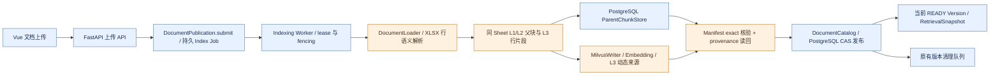
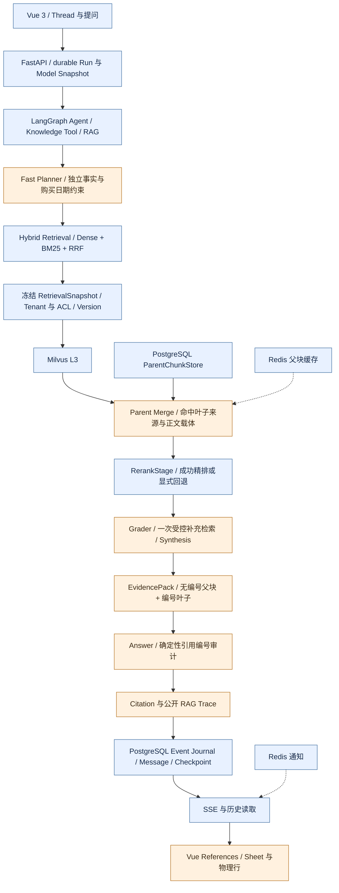

# SuperMew-TraceRAG

基于 [SuperMew](https://github.com/icey1287/SuperMew) 二次开发的企业级可溯源 Agentic RAG 知识库问答系统。

面向产品参数、库存 Excel、技术手册和售后政策：不仅返回答案，还要回答“来自哪个文档版本、哪个 Sheet、哪一行”。本项目在原有 RAG 平台上增强**表格感知解析、细粒度证据归因、来源追踪、跨文档证据覆盖和可复现评估**，没有从零重建 FastAPI、LangGraph 或评测平台。

这是虚构企业语料上的工程实践，非真实企业上线经历。唯一一次 60 题冻结评测完成，**原生 Quality Gate 未通过**；完整结果与限制均保留。

## 目录

- [核心功能](#核心功能)
- [技术架构](#技术架构)
- [二次开发贡献](#二次开发贡献)
- [关键技术设计](#关键技术设计)
- [快速开始](#快速开始)
- [实际使用示例](#实际使用示例)
- [真实评测结果](#真实评测结果)
- [已知限制](#已知限制)
- [文档与质量检查](#文档与质量检查)
- [来源与许可证](#来源与许可证)

## 核心功能

| 能力              | 已实现范围                                                                                                |
| ----------------- | --------------------------------------------------------------------------------------------------------- |
| XLSX 表格感知解析 | openpyxl 只读解析可见多 Sheet，单行表头；逐行绑定列名、值和原始单位，保留物理行号                         |
| 三级 Chunk        | 在上游 L1/L2/L3 框架中增加同 Sheet 父块、行/长行片段叶子；保留版本化 Chunk ID 与正文哈希                  |
| 可追溯索引        | Milvus Dynamic Metadata 保存 `sheet_name / row_start / row_end / source_anchor`，写后读回核验             |
| 安全发布          | 复用 Document Version、Manifest、Worker lease/fencing 与 PostgreSQL CAS；候选未发布前不可检索             |
| Parent Merge      | 保存真实命中叶子来源及有界正文载体，不把父块全部覆盖行当成命中行                                          |
| 精准 Evidence     | 无编号父块提供理解上下文；真实叶子身份、正文哈希和作用域校验后作为独立可引用 Evidence                     |
| 来源传递与展示    | 来源经 RetrievedChunk、EvidencePack、Trace、Checkpoint、Event/Message 到 Vue；实时 SSE 与历史采用同一投影 |
| 跨文档覆盖        | 复用 Fast Planner、Retriever、Grader、Synthesis；独立事实规划、缺失证据查询及一次受控补充召回             |
| 模型兼容          | 按显式 Profile ID/version 选择 DeepSeek Function Calling，仅结构化请求关闭 Thinking，保留 Pydantic 校验   |
| Rerank            | 沿用有界精排及失败回退，在现有 HTTP Adapter 增加 Jina/DashScope 协议兼容；失败不伪装健康空结果            |
| 可复现评估        | 固定 seed、唯一业务事实源、SHA-256、80 Case、20-dev/60-frozen；复用原生 Evaluation CLI 与持久 Worker      |

第一版 XLSX **不支持**公式计算、合并单元格、多级表头或隐藏 Sheet 摄取；遇到不支持结构明确失败，不猜测数据。四份实际 Excel Fixture 各为单 Sheet，多 Sheet 能力由单测覆盖。

## 技术架构

技术栈：Python 3.12+ / FastAPI / Pydantic / SQLAlchemy / Alembic / LangChain / LangGraph / PostgreSQL / Redis / Milvus / Vue 3 / TypeScript / Pinia / Vite。

图中蓝色为上游复用，橙色为本次新增或实质增强；箭头表示数据与调用关系，不表示新增独立服务。

### A. 文档入库与版本发布



上传只提交持久任务；解析、向量化和写入由 Worker 执行。Manifest 核验身份、数量和正文哈希，**不覆盖来源元数据哈希**，所以另做 `verify_provenance`。失败候选不切换 current pointer；新 Parser/Chunker 使用新 Build Fingerprint，不原地覆盖 READY 索引。

### B. 提问、证据与引用



Snapshot 的冻结恢复属于本次增强，基本版本隔离来自上游；RerankStage、规划/评判/合成节点亦为上游已有，增强不等于新增图拓扑。PostgreSQL 是持久事实源，Redis 仅通知/缓存，不是第二套事实数据库。Evaluation Worker 复用正式 RAG 与 Answer/Evaluator，输出原生 Observation/Report，不另写简化 RAG。

## 二次开发贡献

### 上游已具备

在本地上游基点 `e2ebabe` 与当前实现的 Git Diff 中确认：Thread/Run/Event、鉴权与 Tenant/ACL、模型控制面、LangGraph/HITL、三级文本分块、Dense+原生 BM25/RRF、Auto-merging、可选 Rerank、EvidencePack、Document Catalog/Version/Manifest/CAS、索引清理 Worker、Evaluation Contract/Worker、Vue 聊天和基础引用组件均已存在。

### 本次新增与实质修改

| 贡献               | 实际源码入口                                                                                                                                                                                                                  | 解决的问题                                              |
| ------------------ | ----------------------------------------------------------------------------------------------------------------------------------------------------------------------------------------------------------------------------- | ------------------------------------------------------- |
| 确定性企业资产     | [generate_synthetic_enterprise.py](scripts/generate_synthetic_enterprise.py)：`make_records / make_cases / build_assets / generate`                                                                                           | 文档和 Gold 同源，稳定划分、哈希与人工文件保护          |
| XLSX 行语义与来源  | [excel_parser.py](backend/indexing/excel_parser.py)：`parse_excel_rows`；[excel_provenance.py](backend/indexing/excel_provenance.py)；[document_loader.py](backend/indexing/document_loader.py)：`DocumentLoader._load_excel` | 列头与行值绑定，多 Sheet 身份不碰撞                     |
| 索引持久化核验     | [milvus_writer.py](backend/indexing/milvus_writer.py)：`write_versioned_documents / verify_provenance`；[milvus_client.py](backend/indexing/milvus_client.py)；[publication.py](backend/documents/publication.py)             | 动态来源写入/读取，新 Build 与原发布链兼容              |
| 来源契约与恢复     | [rag.py](backend/schemas/rag.py)：`ExcelSource / MatchedLeafSource / RetrievedChunk`；[retrieval.py](backend/documents/retrieval.py)：`RetrievalSnapshot`；[checkpoint_runner.py](backend/rag/checkpoint_runner.py)           | 来源不在 Trace/Checkpoint 丢失，恢复不改绑最新版本      |
| 叶子级引用归因     | [evidence.py](backend/rag/evidence.py)：`citation_leaves / pack_evidence / audit_citations`；[utils.py](backend/rag/utils.py)：`_merge_to_parent_level / dedupe_documents`                                                    | 父块理解与精准引用分离，拒绝错 scope/hash 叶子          |
| 跨文档覆盖         | [pipeline.py](backend/rag/pipeline.py)：`classify_complexity / EvidenceGrade / _resolve_route / rewrite_question_node`                                                                                                        | 在原节点和一次重写预算内补缺失事实，保留前轮证据        |
| 模型与 Rerank 兼容 | [models.py](backend/agent/models.py)：`DeepSeekStructuredChatOpenAI / ModelRegistry.get`；[rerank.py](backend/providers/rerank.py)：`HttpxRerankerAdapter`                                                                    | 不关闭校验、不全局关闭 Thinking，不新增模型客户端       |
| Vue 精准来源       | [ragSources.ts](frontend/src/utils/ragSources.ts)、[References.vue](frontend/src/components/Chat/References.vue)、[KnowledgeContextPanel.vue](frontend/src/components/Chat/KnowledgeContextPanel.vue)                         | 数字引用只绑定入选证据，非连续行不扩大为连续范围        |
| 原生评测与审计     | [runtime.py](backend/evaluation/runtime.py)、[audit_rag_citations.py](scripts/audit_rag_citations.py)                                                                                                                         | 最终回答/引用对齐，按真实 Version/Leaf 审计而非构造身份 |

完整差异与测试映射见 [最终总结](docs/second-dev/s5-final-summary.md)。未新增 PostgreSQL/Milvus 固定 Schema、第二套评测框架或 Citation Store。

## 关键技术设计

1. **表头与行值绑定**：普通大段表格文本可能包含表头，但叶子中不一定保留列值对应。行语义表示为“Sheet：产品参数；型号：NX-017；额定功率W：135 …”。此处是结构说明，真实运行示例见下文。空行跳过但不重编号，长行拆片重复第一列身份，不跨 Sheet 组父块。
2. **Provenance 到前端**：物理行 → Milvus 动态字段 → 合并的 `matched_leaf_sources` → 正式 RetrievedChunk → Evidence/Trace → Event/历史 → Vue。锚点不替代版本化 Chunk ID，`page_number=0` 不冒充行号。
3. **理解上下文 ≠ 事实引用**：父块可辅助理解，但仅同 Tenant/KB/Version/Index/ACL、正文 SHA 校验通过的真实命中叶子可生成精确 Evidence。缺可靠载体时显式父块级降级；合法身份不等于 Claim 被证据蕴涵。
4. **跨文档覆盖**：将参数、购买日期与保修拆为独立事实，Grader 区分“用户没给条件”和“已有条件但证据没找到”。复用一次补充检索预算并合并旧证据，不无限循环；最终漏事实与状态分歧仍如实计失败。

设计依据：[Excel](docs/second-dev/s2-excel-parser-design.md)、[索引来源](docs/second-dev/s2-index-provenance.md)、[来源契约](docs/second-dev/s3-provenance-contract.md)、[冻结恢复](docs/second-dev/s3-evidence-checkpoint.md)、[叶子归因](docs/second-dev/s4a-evidence-attribution-design.md)、[跨文档覆盖](docs/second-dev/s4b-coverage-implementation.md)、[ADR-0027](docs/adr/0027-rag-provenance-and-frozen-resume.md)。

## 快速开始

### 1. 环境与依赖

Python ≥3.12，uv；Node `^20.19.0 || >=22.12.0`，npm ≥10（声明 npm@10.9.7）。需要 PostgreSQL、Redis 与支持原生 BM25 的 Milvus。API、Indexing Worker、Evaluation Worker 必须共享数据库、上传目录和 BuildProfile。

实际联调平台为 **Windows + WSL Ubuntu-24.04、Python 3.12.3、CPU Embedding**；前端实测 Node 24.15.0/npm 11.12.1，后者不是声明的 npm 版本。以下 Linux/WSL 命令按正式入口核对，S5 未重新部署全新机器，不宣称跨平台一键安装验证通过。

```bash
git clone https://github.com/Yu050318/SuperMew-TraceRAG.git
cd SuperMew-TraceRAG
cp .env.example .env
uv sync --dev --locked
cd frontend
npm ci
npm run build
cd ..
```

编辑 `.env` 后再启动；**不得直接使用模板密码和 Secret 占位符**。如果使用现有 PostgreSQL/Redis/Milvus，填写现有隔离开发资源，不启动第二套服务占用相同端口。仓库 `docker-compose.yml` 仅启动依赖，不包括三类应用进程：

```bash
docker compose up -d
```

Compose 是仓库提供的配置入口，不是本轮新执行的部署实验；已有 Milvus 数据卷勿擅自替换/重建。部署前读 [部署 Runbook](docs/runbooks/deployment.md) 与 [索引 Worker Runbook](docs/runbooks/persistent-indexing-worker.md)。

### 2. 配置与迁移

| 配置组       | 必须核对的变量                                                                                                     |
| ------------ | ------------------------------------------------------------------------------------------------------------------ |
| 持久数据     | `DATABASE_URL / REDIS_URL / MILVUS_HOST / MILVUS_PORT / MILVUS_COLLECTION / UPLOAD_DIR`                            |
| 模型首次种子 | `ARK_API_KEY / BASE_URL / MODEL / FAST_MODEL / GRADE_MODEL / EVALUATION_MODEL`                                     |
| 安全         | 自行生成至少 32 字符 `JWT_SECRET_KEY`；设置管理员注册所需 `ADMIN_INVITE_CODE`，生产其他 Secret 按模板/Runbook 配置 |
| Embedding    | `EMBEDDING_MODEL=BAAI/bge-m3`、固定 `EMBEDDING_MODEL_REVISION`、`EMBEDDING_DEVICE`、`DENSE_EMBEDDING_DIM=1024`     |
| XLSX Build   | `DOCUMENT_PARSER_VERSION=document-loader-excel-v3`、`DOCUMENT_CHUNKER_VERSION=three-level-excel-row-v3`            |
| 可选精排     | `RERANK_MODEL / RERANK_BINDING_HOST / RERANK_API_KEY`，以及 timeout、candidate/字符限制、min_score                 |

模型供应商自行选择，不依赖本项目作者的私人网关。模板的模型变量只负责首次种子，已有数据库应通过模型中心配置 Answer/Fast/Grader/Evaluator Assignment；新 Run/Job 冻结 Model Snapshot。Rerank 来自 Settings，不是第五个持久 ModelRole。

针对兼容 DeepSeek 网关，在 `MODEL_STRUCTURED_OUTPUT_POLICIES` 以**实际 Profile ID:version** 配置 `deepseek_function_calling`。示意键不可直接使用：

```json
{ "<实际ProfileID>:<实际版本>": "deepseek_function_calling" }
```

仅对应结构化请求走 Function Calling 并关闭 Thinking；其他 Provider 默认策略、普通对话行为和 Pydantic 校验不变。不要凭模型名自动套用，不要把 Schema 失败当成功。

```bash
uv run --no-sync alembic upgrade head
uv run --no-sync python -m backend.tools.registry_cli validate
uv run --no-sync python -m backend.launcher --no-reload
```

正式 launcher 监督 API、Indexing Worker、Evaluation Worker。应用入口通常为 `http://127.0.0.1:8000`，OpenAPI 为 `/docs`，就绪检查为 `/health/ready`；Ready 200 **不替代** Collection 实际查询与 Manifest 核验。

Windows 后端应在 WSL 运行，Registry 依赖 Linux 文件系统安全能力，不建议 Windows 全局 Python。现有 [start-wsl.ps1](scripts/start-wsl.ps1) 默认 Ubuntu-24.04，并要求事先创建/安装其指定的 WSL 用户目录 venv；它不是安装器：

```powershell
.\scripts\start-wsl.ps1
```

若使用仓库 `.venv`，直接在 WSL 使用上面的 `uv run --no-sync python -m backend.launcher`。当前 `start.sh` 曾因 CRLF shebang 失败，README 不将其列作已验证入口。CPU-only 依赖安装与当前环境差异见 [冻结准备](docs/second-dev/s4e-freeze-readiness.md)，不要用冲突全局环境代替锁定依赖。

独立前端开发终端：

```bash
cd frontend
npm run dev
```

默认开发端口 3000，代理到后端 8000；生产构建由 FastAPI 静态托管。

### 3. 示例语料导入与评测边界

```bash
uv run --no-sync python scripts/generate_synthetic_enterprise.py --check
uv run --no-sync python scripts/evaluate_rag.py validate --dataset evals/rag/synthetic_enterprise/dataset_dev_v1.json
uv run --no-sync python scripts/generate_rag_eval_schemas.py --check
```

已提交生成资产。首次缺文件时可运行生成器不带 `--check`；它不会覆盖不同内容的人工文件。固定 seed=20261010，200 产品、100 维修；详见 [资产说明](evals/rag/synthetic_enterprise/README.md)。

创建专用测试知识库，**仅选择 [manifest.json](evals/rag/synthetic_enterprise/manifest.json) 的 `ingestion_allowlist`**：4 XLSX + 8 HTML，经文档上传页/正式 `POST /documents/upload/async` 提交。等待 12/12 READY，检查 Worker、实际 Version/Manifest/Index 身份；记录本环境新生成身份，不复制历史 ID。

禁止递归上传整个评测目录；`source_records.json`、Dataset、参考答案、Ground Truth 和 manifest 都不能摄入知识库。8 Markdown 是作者源文档，原上传链使用对应 HTML，不能两份同时上传。

管理员在原生 Evaluation 工作台导入 20-dev 并创建持久 Job，先确认模型预算和知识库隔离，结果由正式 Worker 产生。CLI `run` 主要观察检索图，不等同于完整 Answer/Judge Job。60-frozen 已于 S4-E 使用一次，不能据此调参后再宣称 untouched test；本轮没有重新评测。离线 `score` 仅验证契约，不代表 Live 效果，旧 baseline fingerprint 不匹配不能绕过。

## 实际使用示例

以下是**已有真实运行的结果概括**，不是新请求、逐字模型转录或示意截图。

| 场景 / Case                            | 实际观测                                                   | 来源与边界                                                                      |
| -------------------------------------- | ---------------------------------------------------------- | ------------------------------------------------------------------------------- |
| Excel 参数比较：冻结 `table_query_017` | NX-017=135 W、NX-037=200 W，判断后者更大                   | 参数表物理第 18/38 行，真实叶子后缀 `p0::l3::16/36`；严格行匹配通过             |
| 参数 + 保修：开发 `cross_document_001` | NX-081、2026-02-01 购买：155 W、24 个月                    | 参数与政策均支持实际答案；前五 Chunk 只覆盖一半 Gold 文档，不能说 Top5 证据齐全 |
| 硬件版本歧义：开发 `table_query_001`   | 问 NX-001 功率时列出 1.0=130 W / 2.0=120 W，并请求确认版本 | 业务上可解释为谨慎澄清；原生契约预期 ANSWERABLE，仍自动失败，未人工改判         |

前两类及版本边界见 [冻结质量复盘](docs/second-dev/s4e-quality-analysis.md) 和 [健康 Rerank 开发基线](docs/second-dev/s4d-healthy-rerank-baseline.md)。S3 另有真实 Vue/SSE/点击引用/刷新历史 Smoke，见 [前端联调报告](docs/second-dev/s3-frontend-citations.md)。

本轮未新增或公开未审查截图；本地真实截图与 Run 导出处于忽略目录。可公开截图的拍摄位置、脱敏清单与十分钟 Demo 路径见 [项目展示](docs/second-dev/s5-project-showcase.md)。

## 真实评测结果

2026-10-13，唯一一次冻结原生 Evaluation Job：`rag_eval_64d66d2ec2aa4d2bb047e1df01f0d7b6`，60/60 完成、attempts=1。执行成功**不等于**质量门禁通过。[正式报告](docs/second-dev/s4e-final-evaluation.md) 是指标主记录。

| 指标                               | 实测结果                   | 口径                                                      |
| ---------------------------------- | -------------------------- | --------------------------------------------------------- |
| 受控数据                           | 12 份文档、80 问题         | 4 XLSX + 8 HTML 入库；虚构企业，200 产品                  |
| 划分                               | 20 dev + 60 frozen         | 互斥，冻结题不参与此前开发调参                            |
| 冻结 Case Pass                     | **40/60，66.67%**          | Outcome、HITL、Judge、Provider 等原生检查，不是回答准确率 |
| Document Recall@5                  | **84.91%，n=53**           | 有 Gold 文档 Case 宏平均，超时计 0                        |
| Document Recall@10                 | **94.34%，n=53**           | 在最终 Chunk 排名截断匹配文档，非去重文档 Top-K           |
| Citation Validity                  | **120/120**                | 引用编号与 Evidence 身份合法，不等于事实支持正确率        |
| Strict Row-level Citation Accuracy | **30/33，90.91%**          | 有行 Gold 的 Case 引用行集合严格相等                      |
| Excel Provenance Coverage          | **139/139**                | 已导出最终检索 XLSX 记录来源完整，不表示全部业务行召回    |
| P50 / P95                          | **7.201s / 11.947s，n=60** | 含 Judge 和失败；非首 Token、非并发 SLA                   |
| Provider Timeout                   | **1 次**                   | retrieval-stage；不能断言已定位为 Snapshot 或 Milvus      |
| 原生 Quality Gate                  | **FAIL**                   | Case Pass 未达到 0.95 门禁，未降低阈值                    |

分组 Pass：简单事实 14/15、表格 14/15、跨文档 12/15、无答案 0/7、版本/政策 0/8。无答案与版本题存在文本业务语义和原生 Outcome 分歧，保留自动失败。

Judge correctness=0.9610、groundedness=0.9746、completeness=0.9568（n=59）是**连续平均分**，不得写成“回答准确率 96.1%”。缺完整 Gold Chunk，Chunk Recall/MRR/nDCG 未测；缺 Claim 标注，全面事实 Citation Accuracy 未测。没有原版同集冻结结果，**不声称冻结集 A/B 提升**。开发历史数据仅用于调查，不与冻结分母混用。

## 已知限制

- 原生 Quality Gate 未通过；不能宣称生产发布质量达标。
- 已通过真实 Parent 正文和正式 Pack 只读复现：Grader 每文档 1200 字符预算可能截断必要 Excel 行；完整运行 Prompt 缺失，不能将其认定为全部失败的唯一原因。
- 无知识/版本问题的 Outcome 与谨慎回答存在契约分歧；人工认可不改写 Pass。
- 有 retrieval Provider Timeout；此前 Snapshot Timeout 仍需独立诊断，Rerank 恢复不等于 Snapshot 已修复。
- 冻结 Job 未保存完整 Rerank 阶段计数/前后排序/耗时、实际调用量、Token 和费用；预检成功不能代替全程成功率。
- Milvus 在冻结验收时健康、12/12 READY，但容器重建后路径映射恢复未完整演练；S5 未再次检查/修复服务。
- 并发性能、生产 SLA、完整发布门禁、非 Excel Chunk Gold 与 Claim 级引用支持未验证。
- 来源/Checkpoint 有界；缺快照的旧暂停 Checkpoint 明确拒绝恢复，历史已完成消息可文件级展示；不承诺无限保留旧版本。

## 文档与质量检查

- [项目展示与面试 Demo](docs/second-dev/s5-project-showcase.md)
- [阶段总结、完整贡献与简历草稿](docs/second-dev/s5-final-summary.md)
- [S0 源码分析](docs/second-dev/repo-analysis.md)
- [S1 数据设计](docs/second-dev/s1-data-design.md) / [S1.5 Live 基线](docs/second-dev/s1.5-live-baseline.md)
- [S2 开发对照](docs/second-dev/s2-ab-evaluation.md) / [S4-A 行归因](docs/second-dev/s4a-evaluation.md)
- [S4-B 覆盖实验](docs/second-dev/s4b-evaluation.md) / [S4-D 健康精排](docs/second-dev/s4d-healthy-rerank-baseline.md)
- [S4-E 冻结准备与测试记录](docs/second-dev/s4e-freeze-readiness.md) / [最终评测](docs/second-dev/s4e-final-evaluation.md) / [质量复盘](docs/second-dev/s4e-quality-analysis.md)
- [完整仓库质量门禁](docs/runbooks/repository-quality-gates.md) / [前端门禁](docs/runbooks/frontend-quality-gates.md) / [原生评测说明](evals/rag/README.md)
- [上游整体架构资料](docs/architecture/supermew-system-architecture.html) / [领域术语](CONTEXT.md)

最近 S4-E 相关回归是后端 **670 passed / 4 failed，另 62 subtests**；前端 **230 passed / 27 files**，typecheck/lint/build 通过。后端四项失败包括两项历史 fingerprint 不匹配、组合 ModelRegistry 测试环境污染现象和 Bash CRLF；format check 两个既有差异。不是全仓库全绿，S5 不重复执行模型/完整测试。

可自行在隔离锁定环境运行下列聚焦测试；本轮仅检查文档：

```bash
uv run --no-sync pytest -q tests/test_synthetic_enterprise.py tests/test_excel_parser.py tests/test_excel_provenance.py tests/test_evidence_attribution.py tests/test_rag_provenance_contract.py tests/test_rag_cross_document_coverage.py tests/test_deepseek_structured_output.py tests/test_reranker_adapter.py
uv run --no-sync python scripts/generate_contract_types.py --check
uv run --no-sync python scripts/generate_rag_eval_schemas.py --check
```

真实 Run、模型导出、身份映射、截图、日志只存本地 `.artifacts/`。勿使用 `git add .` 混入 IDE 配置或未审查产物。

## 来源与许可证

上游作者 **icey1287**，项目 [SuperMew](https://github.com/icey1287/SuperMew)。本仓库保留原 [MIT LICENSE](LICENSE) 与 `Copyright (c) 2026 icey1287`；2026-10-13 核对 [上游 LICENSE](https://github.com/icey1287/SuperMew/blob/main/LICENSE) 与本地一致，本次修改未更换代码许可或删除署名。MIT 二次开发应继续附带原版权和许可声明。

虚构合成资产的 [manifest](evals/rag/synthetic_enterprise/manifest.json) 声明 CC0-1.0，生成器沿用仓库 MIT 代码许可；这不替代所有依赖、模型权重及新增真实业务数据的单独许可审查。
