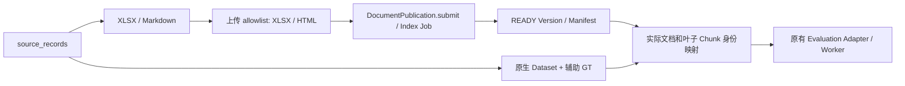

# S1 数据设计与源码确认

日期：2026-10-10。范围为合成资产、生成器、离线测试、原生 Evaluation 适配；生产 API、数据库、Milvus schema、LangGraph 和检索算法均未修改。

## 1. 对 S0 遗留假设的实际确认

### 发布与 BuildProfile

真实类是 `backend/documents/publication.py:DocumentPublication`。`submit(stored_upload, owner_id)` 通过 `ensure_knowledge_base` 和 `reserve_upload(processing_profile=self.config.build_profile, ...)` 建立持久 Index Job。`DocumentPublicationConfig.from_runtime()` 读取 `DOCUMENT_PARSER_VERSION`（默认 `document-loader-v2`）、`DOCUMENT_CHUNKER_VERSION`（`three-level-800-100-v2`）、Embedding 模型与 revision、`DOCUMENT_INDEX_VERSION`（`catalog-v1`）。属性 `build_profile` 返回 `backend/documents/catalog.py:BuildProfile`。

`run()` 委托 `_run_once()`；后者用 `_recorded_build_profile()` 校验 Version 的记录 fingerprint，并以 `_assert_worker_build_profile()` 防止 worker 能力与 candidate 不同。真实解析调用为：

```python
documents = self.loader.load_document(
    str(source_path), build.document.canonical_name,
    metadata=DocumentArtifactMetadata(
        tenant_id=build.document.tenant_id,
        knowledge_base_id=build.document.knowledge_base_id,
        document_id=build.document.id,
        document_version_id=build.version.id,
        index_version=build.version.index_version,
    ),
)
```

返回 `list[dict]`，字段包括 text、filename、file_type、page_number、chunk_id、parent/root ID、chunk_level、chunk_idx、Tenant/KB/Document/Version/section/index identity、acl_tags、content_hash。L1/L2 进入 `ParentChunkStore.upsert_documents`；L3 进入 `MilvusWriter.write_versioned_documents`。exact verify 后，`_manifest()` 将 chunk_id、content_hash、store_kind、section_id、chunk_level 投影为 `ManifestEntry`，再 `record_manifest` 和 `_publish_with_reconciliation` 完成 CAS 发布。`IndexingWorker._run_index` 仅拥有 lease、调用、错误/重试边界。

### ParentChunk 与 Milvus provenance

`backend/db/models.py:ParentChunk` 没有通用 metadata/provenance JSON 列。唯一 JSON 字段为有既定授权语义的 `acl_tags`；其余为固定身份、text、filename、file_type、file_path、page_number、parent/root/chunk 层级和 content_hash。`ParentChunkStore.upsert_documents`、`_to_dict` 是固定白名单，未知 sheet/row 元数据不会持久化或回读。Redis 只缓存相同投影，不能作为 provenance 权威存储。

`backend/indexing/milvus_client.py:MilvusStore.ensure_collection` 开启 `enable_dynamic_field=True`，这意味着存储技术上存在动态字段扩展空间；但当前 `MilvusWriter.write_versioned_documents` 的 insert_data 不包含 sheet/row，`RETRIEVAL_OUTPUT_FIELDS` 不查询这些字段，`_format_retrieval_hit` 也不返回。Hybrid/Dense 的返回流程都是搜索 → `_single_query_hits` 形状检查 → `_format_retrieval_hit` → `utils.retrieve_documents` → parent merge/rerank → `pipeline`/`RetrievedChunk`。

结论：当前正式链路不能在不改代码的情况下保留 Excel provenance。未来不改 PostgreSQL schema 的可选路径是使用已开启的 Milvus dynamic metadata，并让 parent 展开保留命中叶子来源；需要专项证明父级合并、授权 scope、输出字段和旧 collection 兼容。如果希望 ParentChunk 作为结构化 provenance 的权威源，则需要明确 migration；不能把它藏进 ACL、file_path 或假页码。S1 不作该设计的实现决策。

### Markdown 格式差异

`backend/security/uploads.py:_SUPPORTED_EXTENSIONS` 及 `DocumentLoader.load_document` 不包含 Markdown；实际支持 PDF/Word/Excel/HTML。因此生成 12 份逻辑文档（4 XLSX + 8 Markdown），同时为原始索引生成 12 个上传文件（4 XLSX + 8 HTML）。这不是增加另一条 RAG 流程；HTML 完全走正式 `html_processor`。所有 HTML projection 通过正式 parser 回归验证事实不丢失。S1 不把 Markdown 支持混入生产代码。

## 2. 原生 Evaluation 字段与边界

| 对象 | 真实字段/约束 | S1 映射 |
| --- | --- | --- |
| `RagEvalDataset` | schema_version=1、name、非空 cases；Case ID 唯一 | 全集/开发/冻结三个原生 JSON |
| `RagEvalCase` | id、tags、critical、question、expected、gold_documents、gold_chunks、reference_answer、required_claims、conflicts、hitl_answers | 类型/split 用 tags；答案/claim 从业务事实推导 |
| `RagExpectedBehavior` | complexity/route/outcome、hitl、acceptable_abstention 等 | 可答题 ANSWERABLE；未知型号 NO_KNOWLEDGE 且 acceptable_abstention=true；不凭空标复杂度/route |
| `RagGoldDocument` | document_id 或 canonical_name 至少一项 | 上传文件 canonical_name；Document ID 留空 |
| `RagGoldChunk` | chunk_id 或 content_sha256 至少一项 | 暂不填；不伪造 versioned ID 或把文件 SHA 当 chunk hash |
| `RagEvalObservation` | ranks、retrieved/initial/rewrite chunks、route/outcome、judge、duration/error 等 | 必须由实际 Adapter/Worker 生成；S1 不构造企业效果 Observation |

NO_KNOWLEDGE 不可携带 Gold；ANSWERABLE 必须有 Gold Document 或 Chunk。本生成器遵循上述校验。`gold_documents.canonical_name` 与 `RagRetrievedChunk.canonical_name`（Adapter 从 filename 投影）匹配。`ground_truth.jsonl` 保存暂时无法在 v1 表达的 Sheet、真实行范围和章节，不扩展正式 Contract。

`scripts/evaluate_rag.py` 的 `validate` 用 `load_rag_eval_dataset`/`dataset_fingerprint`；`score` 用 `PredictionFileAdapter` 读取安全 Observation、核对 Dataset fingerprint，再调用 `evaluate_rag`；`run` 用 `LiveRagEvalAdapter` 调用生产 `run_rag_graph`/HITL interface，并检查真实 `retrieval_index_id` 在 Case 和整个运行间不变。CLI 的 Live Adapter 不生成答案或 Judge，`observation_from_rag_results` 只投影检索结果。答案生成和 `_judge_answer` 实际在 `backend/evaluation/runtime.py:RagEvaluationRuntime`，由持久 Evaluation Worker 驱动。

当前评分器的 MRR/nDCG 是 Gold Chunk 指标；文档名称不能直接充当 Chunk ID。Document Recall@5 可在仅有 Gold Document 时计算。`case_pass_rate` 在 CLI 检索 profile 下也不能称答案准确率；没有 Judge 的答案指标为缺测，且文档 recall 是单独指标，不能从 case pass rate 推断文档全部命中。

## 3. 生成器与唯一业务事实源

`scripts/generate_synthetic_enterprise.py` 的 `make_records(seed)` 创建 source_records；只有此处调用本地 Random，后续渲染没有额外随机事实。

- products：200 个 NX-001…NX-200，类别、功率、重量、协议、价格、库存、版本、生效日期，以及安装/供电/维护/故障处理说明；
- repairs：100 条 REP-0001…REP-0100，产品外键、故障、结论、固定日期；
- policy：2025 12 个月、2026 24 个月，按购买日期适用；
- versions：5 个产品明确的硬件 1.0/2.0 功率差异和日期；
- source_records 记录公司标记、seed、generator version。

`make_facts(records)` 投影事实陈述和 file/sheet/row/section；`table_rows(records)` 构造 Excel 行；`make_cases(records, facts)` 生成原生 Dataset 与辅助 Ground Truth。数字答案、比较关系、保修适用行为均确定性推导，无 LLM。Sheet 表头固定为物理第 1 行；enumerate 起点 2 与实际写入顺序相同。`source_anchor` 格式为 `file::sheet::row` 或 `file::section::section`，只作离线来源位置，不代表已发布 Evidence ID；一个行锚点可以支持多个字段事实。

`build_assets()` 在内存完成全部生成和 `validate_assets()`；校验外键、12 文件 allowlist、类别与 split、Native contract、所有 Excel 表头/单元格值、Markdown 事实/章节、可答证据、跨文档两个独立事实、无答案型号缺失、冲突显式规则。`generate()` 在任何写入前检查全部目标是否同内容，并拒绝 corpus 额外文件和 symlink；不覆盖人工数据。

XLSX 的 created/modified 与 ZIP 成员时间固定，成员排序固定；所有 JSON UTF-8、排序键、固定日期、稳定产品/Case ID。Manifest SHA-256 覆盖全部生成文件（manifest 本身除外），保存 native Dataset fingerprint 与 source→upload mapping。生成脚本、README 和 Ground Truth 位于索引清单外，运行时输出放 `.artifacts/synthetic-enterprise/`。

## 4. 80 条分层划分

| 类型 | 全集 | 开发 | 冻结 |
| --- | ---: | ---: | ---: |
| 简单事实 | 20 | 5 | 15 |
| 表格字段/两产品比较 | 20 | 5 | 15 |
| 跨文档（参数+售后、协议+安装） | 20 | 5 | 15 |
| 不存在型号/拒答 | 10 | 3 | 7 |
| 产品版本/保修政策 | 10 | 2 | 8 |
| 合计 | 80 | 20 | 60 |

划分用确定性的 Case 序号，生成后保存在 splits 和 tags，不运行时重抽样。全部 12 文档属于测试语料；本版题目重点覆盖参数、价格、库存、说明、政策、FAQ、供电、故障与版本，维修明细/选型指南目前主要提供关联与干扰语料，后续不能据此宣称这两个切片问答已验证。无答案问题为 NX-901…NX-910，其业务 ID 在全部事实和文档中不存在。比较只比较两个给定值，不引入任意统计任务。

人工复核清单在 `evals/rag/synthetic_enterprise/manual_review.md`，覆盖五类各两条。复核重点是打开真实文件核对行与表头、保修日期和版本、跨文档必要性及拒答；保留待勾选状态，自动校验不冒充人工确认。

## 5. 真实索引身份映射与 S2 前置



离线来源身份为 `manifest.documents.source_id`，原生文档匹配身份为 canonical_name。索引后用上传返回的 Document/Version ID、Catalog current Version、实际 Manifest 的 chunk_id/content_hash 建立 `.artifacts/` 映射，并绑定 Tenant/KB/build/index fingerprint。Gold Chunk 必须人工/确定性地确认实际文本确实支持对应事实，不能盲目把整个文档所有 chunk 填成 Gold。row anchor 后续由 S2 parser 提供真实对应；原始通用 Excel parser 不承诺精确行号映射。

S2 建议改动仅在现有 `DocumentLoader` 的 XLSX 分支，复用 `DocumentArtifactMetadata` 和三级层级；按有界行组生成 parent 并保留 leaf 来源集合。再审查 Milvus dynamic metadata 或 ParentChunk migration 的具体选择、`MilvusWriter`/输出白名单、merge provenance 和 cleanup。parser/chunker fingerprint 必须变化，API 与 worker build 能力一致；新 candidate 经 exact verify/CAS 后发布，旧 READY 持续服务。Sheet/Row 前端和正式引用校验留给 S3。

另发现已有 baseline 的源码 fingerprint 与 HEAD 不一致，以及 Windows checkout CRLF 造成 corpus 字节 hash 不同；详情和实际测试结果见 [S1 评测基线](s1-evaluation-baseline.md)。S1 保留原 baseline，不通过覆盖 hash 或关闭校验处理这些问题。
